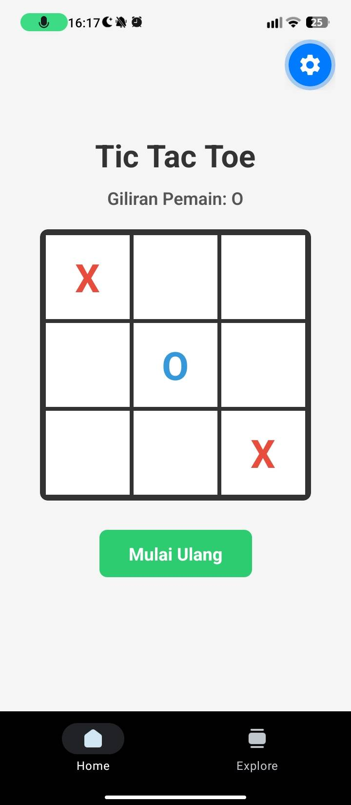
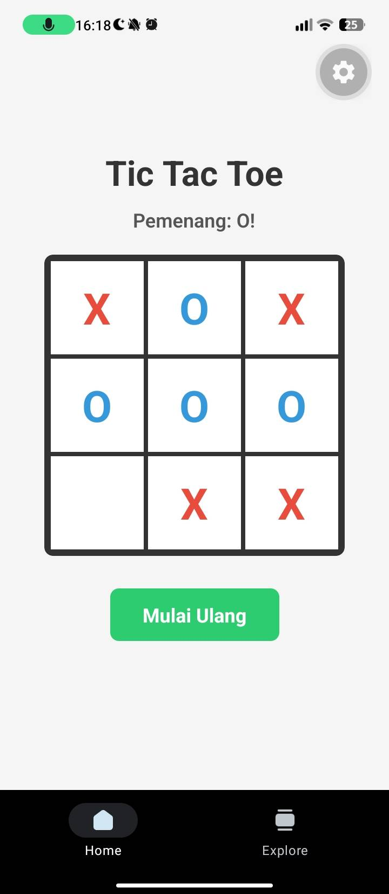

# 📱 Tugas Praktikum / Proyek Pemrograman Mobile
# Permainan Tic Tac Toe - React Native & Expo

Repositori ini dibuat untuk memenuhi penugasan mata kuliah pemograman mobile menggunakan **React Native** dan **Expo**.

---

## 📸 Dokumentasi Tampilan Aplikasi (Expo Go)

Berikut adalah tangkapan layar (*screenshot*) saat aplikasi dijalankan di perangkat:

| Tampilan Permainan Aktif | Tampilan Hasil Permainan |
| :---: | :---: |
|  |  |

---

## 👤 Identitas Mahasiswa
- **Nama:** Halmar Zahran Rasikh Iskandar
- **NPM:** 41155050240012
- **Program Studi:** Teknik Informatika
- **Universitas:** Universitas Langlangbuana

---

## 📋 Tentang Tugas (Tic Tac Toe App)
Aplikasi seluler interaktif sederhana berbasis *cross-platform* yang mengimplementasikan permainan klasik **Tic Tac Toe** (Grid 3x3). Proyek ini dirancang untuk memahami konsep dasar *Front-End Development* pada perangkat mobile, yang mencakup:
1. **State Management** menggunakan React Hooks (`useState`).
2. **Game Logic & Validation** untuk mendeteksi kondisi pemenang secara dinamis maupun kondisi seri (*draw*).
3. **Immutability Principle** dalam pembaruan state array papan permainan.
4. **Responsive Layout** menggunakan sistem *Flexbox* di React Native.

---

## 🚀 Cara Menjalankan Proyek
Bagi penguji atau dosen yang ingin menjalankan kode sumber ini:
1. Pastikan **Node.js** sudah terinstal di komputer.
2. Clone repositori ini ke komputer lokal:
   ```bash
   git clone [https://github.com/USERNAME/NAMA_REPO.git](https://github.com/USERNAME/NAMA_REPO.git)